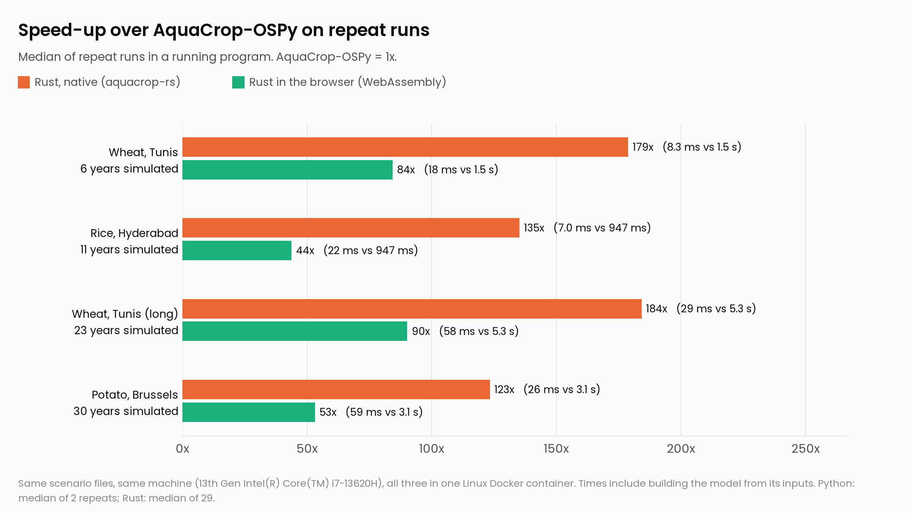

<h1 align="center">aquacrop-rs</h1>

<p align="center">
The AquaCrop crop-water productivity model in Rust and WebAssembly,<br>
ported line by line from AquaCrop-OSPy 3.1.0
</p>

<p align="center">
<a href="https://github.com/jagadeesh-sb/aquacrop-rs/actions/workflows/ci.yml"></a>
<a href="LICENSE"></a>


<a href="CITATION.cff"></a>
</p>

<p align="center">
<a href="#performance">Performance</a> ·
<a href="#what-the-speed-is-for">Applications</a> ·
<a href="#use">Use</a> ·
<a href="#agreement-with-aquacrop-ospy">Validation</a> ·
<a href="docs/README.md">Documentation</a> ·
<a href="#citing">Citing</a>
</p>

aquacrop-rs is a Rust port of [AquaCrop-OSPy](https://github.com/aquacropos/aquacrop) 3.1.0,
the open-source Python implementation of the FAO AquaCrop crop-water
productivity model. It simulates canopy cover, rooting, soil water, soil
evaporation, transpiration, biomass and yield day by day, for one field and
any number of seasons. It builds as an ordinary Rust library and as a
626 KB WebAssembly module that runs in the browser.

The port follows the Python code module by module and keeps its variable
names, so each formula can be read side by side with the original. It is not
an official implementation of FAO AquaCrop, and neither is AquaCrop-OSPy.

## Performance

Measured on 18 November 2026 against AquaCrop-OSPy 3.1.0 on the same
machine ([performance](docs/performance.md), [validation](docs/validation.md)):

| | AquaCrop-OSPy | aquacrop-rs | aquacrop-rs in the browser |
|---|---:|---:|---:|
| One 23-year run, repeated | 5.3 s | 29 ms | 58 ms |
| All 74 reference scenarios, start to finish | 1 min 57 s | 1.8 s | 3.1 s |
| Scenarios identical in every bit (of 65) | | 51 | 0 |
| Largest season yield difference (623 seasons) | | 0 | 0.00076% |

The native build runs the reference scenarios 123 to 184 times faster than
AquaCrop-OSPy once both are running, and 92.9% of its lines are run by the
tests.



## What the speed is for

A single AquaCrop run is quick in any language. The difference shows when a
question needs thousands of runs. The figures below come from the benchmark
machine (Intel Core i7-13620H, 16 threads, Linux container); estimates
multiply the measured time per run and are marked as such.

### Searching irrigation schedules

[`examples/irrigation_sweep.rs`](examples/irrigation_sweep.rs) tries 625
irrigation schedules for wheat at Tunis (four soil-moisture thresholds, one
per growth stage, each at 0, 20, 40, 60 or 80 percent) and runs all 23
seasons from 1979 to 2002 for each one.

```sh
cargo run --release --example irrigation_sweep
```

| | Time for 625 schedules |
|---|---:|
| aquacrop-rs, 1 thread (measured) | 20.5 s |
| aquacrop-rs, 16 threads (measured) | 3.2 s |
| AquaCrop-OSPy, 1 process (estimate: 625 x 5.27 s) | about 55 min |

The same search can be run field by field, with each field's own soil and
weather, which is slow work in Python. At Tunis the rain meets most of the
crop's need: the best schedule raises the mean yield from 9.22 t/ha
(rainfed) to 9.37 t/ha with 32 mm of water a season.

### Calibration and uncertainty

Fitting crop parameters to observed yields or to satellite evapotranspiration
(for example with [Optuna](https://optuna.org) or a Monte Carlo sampler)
takes from thousands to hundreds of thousands of model runs. For 100,000
runs of a 23-year simulation:

| | 100,000 runs |
|---|---:|
| aquacrop-rs, 16 threads (estimate: 100,000 x 5.1 ms) | about 9 min |
| aquacrop-rs, 1 thread (estimate: 100,000 x 32.8 ms) | about 55 min |
| AquaCrop-OSPy, 1 process (estimate: 100,000 x 5.27 s) | about 6 days |

### Regional and climate-change runs

Running every cell of a map under several climate projections multiplies the
runs again. The median cost of one simulated year is 1.2 ms in aquacrop-rs
and 187 ms in AquaCrop-OSPy ([performance](docs/performance.md)). For 1,000
grid cells, 10 climate projections and 30 years each (estimates, one core):
about 6 minutes in aquacrop-rs and about 16 hours in AquaCrop-OSPy.

### Field advice without a server

The WebAssembly build is a 626 KB file with no Python, numpy or pandas behind
it. It ran the 23-year Tunis simulation in 58 ms in Node.js, which runs the
same WebAssembly as a browser. A web or phone app can therefore run the model
on the user's own device, with no server and no network once the page is
loaded. This repository provides the module and the JavaScript usage shown below,
not a finished app.

### Inside other software

Rust programs call the model as a library, and JavaScript calls it through
the WebAssembly module, with no Python runtime in either case. The input is one JSON
document with AquaCrop-OSPy's own names, so models built for AquaCrop-OSPy
carry over.

## Documentation

[White paper (PDF)](docs/aquacrop-rs-white-paper.pdf) ·
[Inputs](docs/inputs.md) ·
[Outputs](docs/outputs.md) ·
[WebAssembly](docs/webassembly.md) ·
[Architecture and modules](docs/architecture.md) ·
[Differences from AquaCrop-OSPy](docs/differences.md) ·
[Validation](docs/validation.md) ·
[Performance](docs/performance.md) ·
[Benchmarks](bench/README.md) ·
[Contributing](CONTRIBUTING.md)

## Agreement with AquaCrop-OSPy

`scripts/golden.py` runs AquaCrop-OSPy 3.1.0 (numpy 2.5.4, pandas 3.0.6) on
74 scenarios and saves every daily output: the AquaCrop-OSPy quick start, the
comparison runs against FAO AquaCrop for Windows that ship with AquaCrop-OSPy
(wheat at Tunis, rice at Hyderabad, potato at Brussels), every irrigation
method, constant and varying water tables, mulches, bunds, the off-season,
CO2 series, custom and texture-based soils, tile drainage, adaptive planting,
crop parameter overrides and every built-in crop. Nine of the scenarios fail
inside AquaCrop-OSPy; the port fails on the eight that fail on AquaCrop's own
checks and runs the ninth, which fails on a pandas 3 incompatibility.

`cargo test --test golden` compares every column of every day:

- On Linux, with the Python references also generated on Linux, all 74
  scenarios agree to 1e-9 and 51 of them are bit-identical on every value of
  every day. In the rest the first difference is in the last bit of a
  soil-evaporation value, after the exponential function, typically hundreds
  of days into the run.
- The WebAssembly build uses Rust's own maths library, whose `exp`, `ln` and
  `pow` can differ from glibc's in the last bit. `node scripts/wasm-check.mjs`
  finds 70 scenarios agreeing day by day to 1e-9. In the other four, a
  threshold (drainage, or the two-decimal rounding of root-zone water) tips a
  day apart; their season yields and irrigation still agree to within a
  relative 1.1e-5.

AquaCrop-OSPy itself gives slightly different daily values on Windows and on
Linux for the same reason, so references are generated on Linux. numpy's
AVX-512 maths can also change the last bit, so the reference runs are made
with it switched off (see [validation](docs/validation.md)).

## Use

```toml
[dependencies]
aquacrop = { git = "https://github.com/jagadeesh-sb/aquacrop-rs" }
```

```rust
let input: aquacrop::ModelInput = serde_json::from_str(&std::fs::read_to_string("run.json")?)?;
let results = aquacrop::run(&input)?;
for s in &results.final_stats {
    println!("season {} harvested {}: {:.2} t/ha", s.season, s.harvest_date, s.dry_yield);
}
```

The input mirrors the arguments of `AquaCropModel` and uses AquaCrop-OSPy's
names and defaults:

```json
{
  "sim_start": "2000-01-01",
  "sim_end": "2010-12-31",
  "weather": {
    "start": "2000-01-01",
    "min_temp": [11.3, 11.3],
    "max_temp": [27.3, 26.7],
    "precipitation": [0.0, 0.0],
    "reference_et": [3.6, 3.7]
  },
  "soil": { "soil_type": "Paddy" },
  "crop": { "name": "localpaddy", "planting_date": "08/01" },
  "initial_water_content": { "wc_type": "Prop", "method": "Layer", "depth_layer": [1, 2], "value": ["FC", "FC"] },
  "field_management": { "bunds": true, "z_bund": 0.2 },
  "irrigation": { "irrigation_method": 1, "SMT": [60, 60, 50, 30] }
}
```

Crop parameters can be overridden by name under `crop.params` (for example
`"CCx"`, `"WP"`, `"Maturity"`). A custom soil takes `layers`, each with either
`th_wp`, `th_fc`, `th_s` and `ksat`, or `sand`, `clay` and `organic_matter`
(Saxton and Rawls 2006). The results hold the daily `water_flux`,
`water_storage` and `crop_growth` tables, one array per column, and
`final_stats` with one entry per harvested season.

### In the browser

```sh
cargo build --profile wasm --target wasm32-unknown-unknown --features wasm
wasm-bindgen --target web --out-dir pkg target/wasm32-unknown-unknown/wasm/aquacrop.wasm
```

```js
import init, { run, crop_names } from './pkg/aquacrop.js'
await init()
const results = JSON.parse(run(JSON.stringify(input)))
```

`run` throws a JavaScript error when the input cannot be simulated.

## Where the port differs

The port follows AquaCrop-OSPy's arithmetic, including two of its less
obvious behaviours: rainfall partitioning shortens the depth of the
compartment that crosses the curve-number depth for the rest of a run, and
net irrigation on the first day of a season changes the water content the
following seasons start from. Where AquaCrop-OSPy raises an exception or
loops forever, the port returns an error or takes the sensible branch
instead. Each such place is marked `Deviation:` in the source. Among them:

- a soil too shallow for the roots, which AquaCrop-OSPy extends without end;
- `ETadj` other than 1, where AquaCrop-OSPy refers to an undefined variable;
- an evaporation or rainfall loop that would index past the bottom of the
  profile;
- a next planting date outside the simulation period, which ends the run;
- a water-table date outside the simulation period, which is rejected.

Salinity, fertility stress and weed management are not simulated, as in
AquaCrop-OSPy 3.1.0.

## Testing

```sh
pip install aquacrop==3.1.0 numpy==2.5.4 pandas==3.0.6
export NPY_DISABLE_CPU_FEATURES="X86_V4 AVX512_ICL AVX512_SPR"   # see docs/validation.md
python scripts/golden.py        # writes tests/golden/, about 90 MB
cargo test
node scripts/wasm-check.mjs     # after building pkg/
```

## Citing

If you use aquacrop-rs, please cite the software (see
[CITATION.cff](CITATION.cff); GitHub's "Cite this repository" button gives
the reference) and the AquaCrop-OSPy paper below.

## Licence and credit

Licensed under Apache-2.0, like AquaCrop-OSPy. The model, its parameter sets and its data are
the work of the AquaCrop-OSPy authors (Foster, Kelly and contributors); see
NOTICE. Please cite their paper when you use this port:

Kelly, T. D. and Foster, T. (2021). AquaCrop-OSPy: Bridging the gap between
research and practice in crop-water modeling. Agricultural Water Management,
254, 106976. https://doi.org/10.1016/j.agwat.2021.106976
