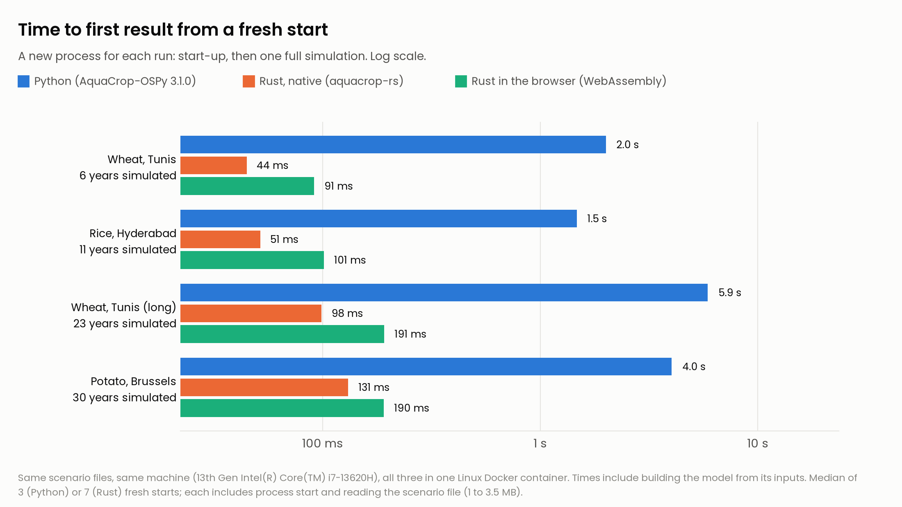
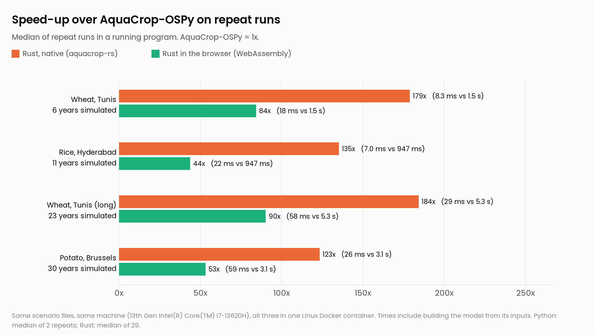
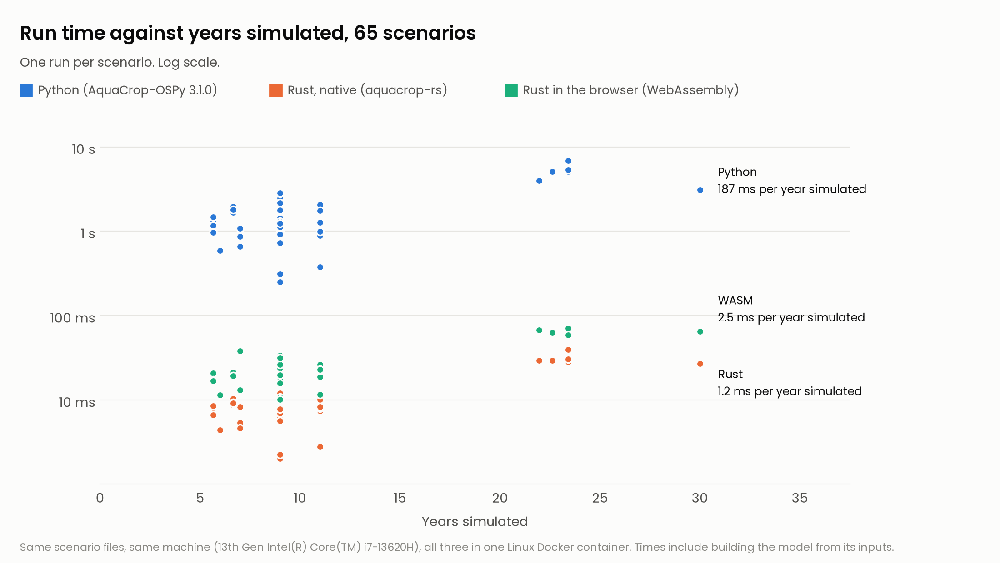
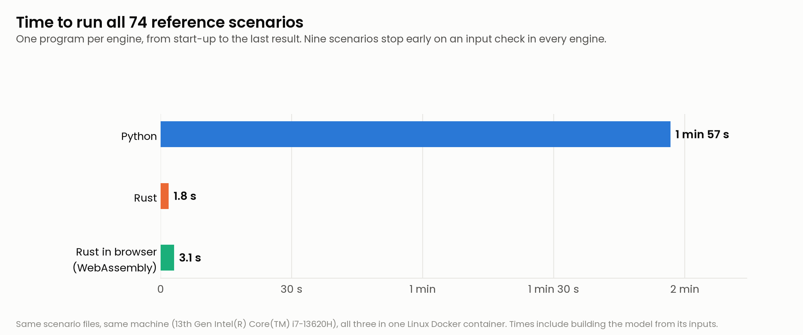

# Performance

Measured on 18 November 2026. All three engines ran the same reference
scenario files on the same machine, inside one Linux container, one run at a
time.

| | |
|---|---|
| Machine | Laptop, Intel Core i7-13620H, Windows 11, Docker Desktop (WSL2 kernel 6.18) |
| Python | AquaCrop-OSPy 3.1.0, Python 3.12.16, numpy 2.5.4, pandas 3.0.6 |
| Rust, native | aquacrop-rs 0.1.0, rustc 1.100.0, release profile (LTO, one codegen unit) |
| Rust, WebAssembly | the same crate built with `--profile wasm`, wasm-bindgen 0.2.129, run in Node.js 26.13.1 |

AquaCrop-OSPy 3.1.0 is plain Python. Earlier versions compiled parts of the
model with Numba; 3.1.0 removed that, so it has no compile step.

Each timing includes building the model from its inputs (weather, soil, crop
and so on), as a caller would. Python's time includes making its pandas
weather table.

## Time to first result

A new process for each run: start the program, load the libraries, read the
scenario file, run one full simulation. Median of 3 fresh starts for Python
and 7 for Rust.

| Scenario | Years | Python | Rust | WebAssembly |
|---|---:|---:|---:|---:|
| Wheat, Tunis | 5.7 | 2.0 s | 44 ms | 91 ms |
| Rice, Hyderabad | 11 | 1.5 s | 51 ms | 101 ms |
| Wheat, Tunis (long) | 22.6 | 5.9 s | 98 ms | 191 ms |
| Potato, Brussels | 30 | 4.0 s | 131 ms | 190 ms |

Python spends about 0.4 s importing numpy, pandas and aquacrop before it
starts. Each figure also includes reading a 1 to 3.5 MB scenario file, which
takes 30 to 230 ms and is the same work for every engine.

## Repeat runs

The same scenario run again in a program that is already running: median of
2 repeats for Python and 29 for Rust, after a first run.

| Scenario | Python | Rust | Faster | WebAssembly | Faster |
|---|---:|---:|---:|---:|---:|
| Wheat, Tunis | 1.49 s | 8.3 ms | 179x | 17.7 ms | 84x |
| Rice, Hyderabad | 0.95 s | 7.0 ms | 135x | 21.6 ms | 44x |
| Wheat, Tunis (long) | 5.27 s | 28.6 ms | 184x | 58.5 ms | 90x |
| Potato, Brussels | 3.15 s | 25.5 ms | 123x | 59.2 ms | 53x |

## Every scenario

Each of the 65 completing scenarios run once. The median cost is 187 ms per
simulated year in Python, 1.2 ms in native Rust and 2.5 ms in WebAssembly.
Time also depends on the crop and settings, so it does not rise evenly with
the number of years.

All 74 scenarios in one program, start to finish: Python 1 min 57 s, native
Rust 1.8 s (64x faster), WebAssembly 3.1 s.

## One-time costs

- A clean release build of the crate took 17 s (crates already downloaded).
- The WebAssembly module is 626 KB and compiles in Node.js in about 13 to
  25 ms.

## Notes

- One run uses one CPU core in every engine. Runs of different fields or
  scenarios are independent and can be spread over cores; that was not
  measured here.
- Times on Windows without Docker were not measured cleanly and are not
  reported.

## Repeat the measurement

See [bench/README.md](../bench/README.md). The raw timings are in
`bench/results/bench.json`.
