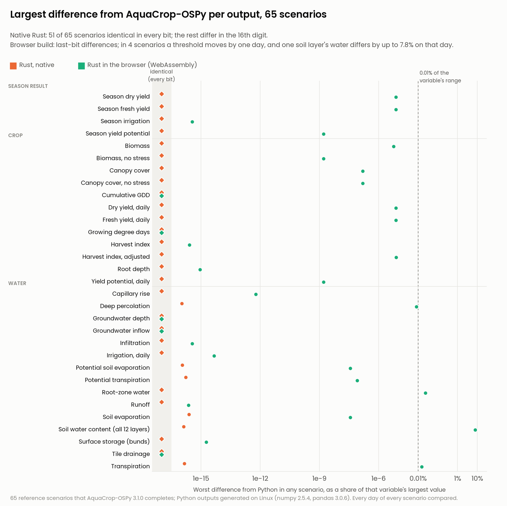
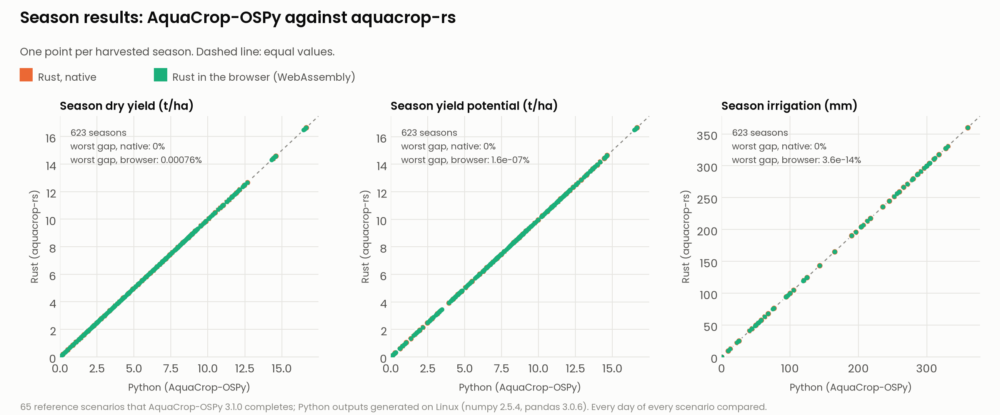
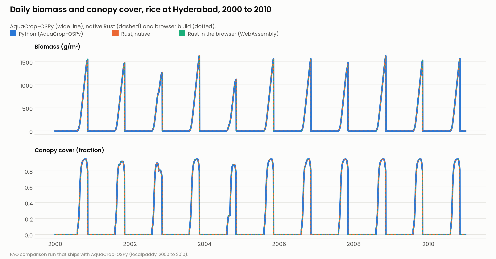
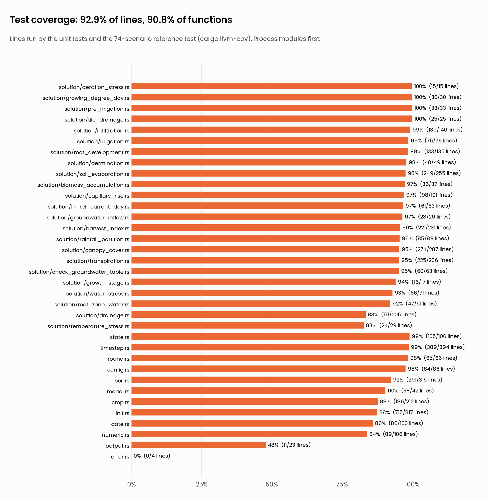

# Validation against AquaCrop-OSPy

aquacrop-rs is checked by running the same inputs through AquaCrop-OSPy
3.1.0 and through the port, and comparing every output column on every day.

## The reference scenarios

`scripts/golden.py` builds 74 scenarios, runs each through AquaCrop-OSPy
3.1.0 (numpy 2.5.4, pandas 3.0.6) and saves the input together with every
daily output in `tests/golden/<scenario>.json`. The scenarios cover:

- the AquaCrop-OSPy quick start (wheat at Tunis);
- the comparison runs against FAO AquaCrop for Windows that ship with
  AquaCrop-OSPy: wheat at Tunis, rice at Hyderabad and potato at Brussels;
- every irrigation method (soil-moisture targets, fixed interval, schedule,
  net irrigation, constant depth);
- constant and varying water tables, and a shallow water table in clay;
- mulches, bunds, curve-number adjustment and runoff stopped;
- off-season simulation, CO2 series and a constant CO2 concentration;
- custom soils from hydraulic properties and from texture, and tile drainage;
- adaptive planting, crop parameter overrides and a switch to a GDD crop;
- every built-in crop, and Indian kharif and rabi crops (maize, paddy,
  cotton, sorghum, soybean, sugarcane, tomato).

The 65 scenarios that complete simulate between 5.7 and 30 years each, 623
harvested seasons in total.
AquaCrop-OSPy completes 65 of them. The other nine fail inside AquaCrop-OSPy;
[differences.md](differences.md) explains each.

## How the comparison is done

`cargo test --test golden` runs every scenario through the port and compares
each column of each daily table and each season statistic with
AquaCrop-OSPy's values. A value passes when `|a - b| <= 1e-9 + 1e-9 * |b|`.
When AquaCrop-OSPy fails on one of its own input checks
(`AssertionError`), the test checks that the port fails too. When it fails
with any other error, such as the pandas 3 problem in `preset_AlfalfaGDD`,
the port is allowed to run.

`node scripts/wasm-check.mjs` does the same for the WebAssembly build. It
reports how many scenarios agree day by day and fails only when a season
result (dry yield, yield potential, irrigation) differs by more than a
relative 1e-4.

CI runs both on every push and pull request, after regenerating the
reference files with AquaCrop-OSPy on Linux.

## Results

Measured on 18 November 2026 with `bench/scripts/compare.py`, which compares
every value of every day without a tolerance and reports the largest
difference for each output, as a share of that output's largest value in the
scenario.

**Native build (Linux).** 51 of the 65 scenarios are identical to
AquaCrop-OSPy in every bit of every value. In the other 14 the largest
difference in any output is 2.5e-16 of its range, the last bit of a 64-bit
number. Every season result (dry yield, fresh yield, yield potential,
irrigation) in all 623 seasons is identical.



**WebAssembly build.** No scenario is identical in every bit, because the
browser build uses Rust's own maths library (see below). Season dry yield
differs by at most 0.00076%, yield potential by at most 1.6e-7% and seasonal
irrigation by at most 3.6e-14%. In four scenarios (`in_cotton_clay`,
`in_cotton_gdd`, `in_sorghum_rabi` and `soil_custom_hydraulic`) a tiny
difference tips a threshold one day earlier or later: drainage, or the
two-decimal rounding of root-zone water. On that day
the water content of one soil compartment differs by up to 7.8% of its range
(`in_sorghum_rabi`, compartment 8). Season results in those scenarios still
agree within the figures above.





## Why the browser build differs in the last bit

The model calls `exp`, `ln` and `pow`. AquaCrop-OSPy on Linux and the native
port both use glibc for these. WebAssembly has no system maths library, so
the browser build uses Rust's `libm`, which can round the last bit
differently. In 61 of the 65 scenarios the largest difference in any output
is 1.1e-12 of its range. In the other four the difference reaches a threshold
(for example, whether a compartment drains on a given day) and change that
day's water balance.

AquaCrop-OSPy has the same issue between operating systems: on Windows it
gives slightly different daily values from Linux. This is why the reference
files are made on Linux.
The CPU matters too. numpy uses AVX-512 versions of `exp` and `log` on
processors that have them (numpy reports these as `X86_V4`), and they can
round the last bit differently from the AVX2 versions. The figures above were
made on a processor without AVX-512. When the reference runs were made on an
AMD EPYC 9V74 with AVX-512 enabled, 2 of the 74 scenarios
(`in_sorghum_rabi`, `soil_custom_texture`) differed from aquacrop-rs in daily
soil water beyond the 1e-9 tolerance. With `NPY_DISABLE_CPU_FEATURES="X86_V4
AVX512_ICL AVX512_SPR"` on the same machine, all 74 agreed. CI sets this
variable when it makes the reference runs.

## Test coverage

31 unit tests and the reference test run 92.9% of the lines and 90.8% of the
functions in `src/` (`cargo llvm-cov`, native build). The 23 daily process
modules are covered between 83% and 100%.



## Repeat the check

```sh
pip install aquacrop==3.1.0 numpy==2.5.4 pandas==3.0.6
python scripts/golden.py            # writes tests/golden/, about 90 MB
cargo test --release
cargo build --profile wasm --target wasm32-unknown-unknown --features wasm
wasm-bindgen --target web --out-dir pkg target/wasm32-unknown-unknown/wasm/aquacrop.wasm
node scripts/wasm-check.mjs
```

The charts on this page are made by the scripts in `bench/`; see
[bench/README.md](../bench/README.md).
